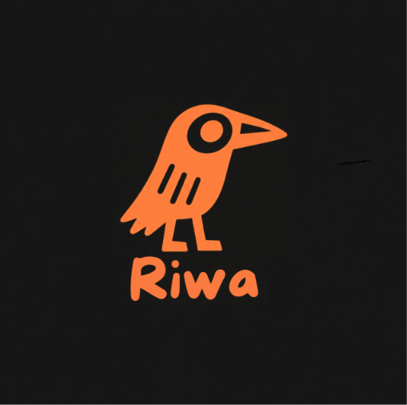

# Hack Uttar Pradesh 2026 | Official Platform
*Powered by Riwa Creatives Foundry ([riwacreatives.in](https://riwacreatives.in))*



> **75 Districts • One Confluence • उत्तर प्रदेश 2026**  
> Statewide hybrid hackathon uniting 5,000+ builders, engineers, and designers across Uttar Pradesh.

---

## 🌿 About the Event

**Hack Uttar Pradesh 2026** is India's first **Open Greens Hackathon**. Moving beyond sterile indoor auditoriums, shortlisted finalist squads assemble at open-air lawn workstations in **Lucknow** (Gomti Riverfront) and **Greater Noida** (Expressway Tech Hub) equipped with 10 Gbps outdoor mesh Wi-Fi, solar battery hubs, kulhad chai bars, and starlit night coding.

### Key Dates
* **Registrations Open:** Until December 31, 2025
* **Phase 1 (Online Prelims & Workshops):** January 01 – January 08, 2026
* **Phase 2 (In-Person Grand Finale):** January 10 – January 15, 2026 *(240 Finalists across 60 Squads)*

---

## 🏆 Prize Pool & Backing
* **1st Place Winner:** ₹20,000 cash + Guaranteed Direct PPO (Pre-Placement Offer) + ₹10L seed incubation term sheet.
* **2nd Place Runner-Up:** ₹15,000 cash + Direct PPI (Pre-Placement Interview) fast-track.
* **3rd Place Second Runner-Up:** ₹10,000 cash + Direct PPI opportunity + software licenses.
* **Corporate Bounties:** Track naming partner bounties across AI, Web3, AgriTech, and Spatial Web.

---

## ⚡ Tech Stack & Architecture

* **Frontend:** Clean Y Combinator (YC) obsidian design system (`#000000`, YC orange `#ff6600`, mint green `#4ade80`), Times New Roman typography, responsive liquid glass navigation, 60fps canvas particle engine (`animation.js`).
* **Backend:** Zero-dependency Node.js HTTP server (`server.js`) serving static assets and RESTful API endpoints.
* **Database:** Native relational SQLite engine (`database.sqlite`) via `node:sqlite.DatabaseSync` with full schema definitions in [`schema.sql`](schema.sql).
* **Authentication:** Google Identity Services (GSI) OAuth integration with instant verified profile auto-fill.
* **Verification System:** Instant SQL pass validation (`/api/verify`) and on-site gate check-in engine (`/api/checkin`).
* **Organizer Console:** Live registry modal with real-time attendee search, CSV export, and complete `.sql` database dumps.

---

## 🚀 Running Locally

### Prerequisites
* [Node.js](https://nodejs.org/) v22+ or v24+ (uses built-in `node:sqlite`, **zero** `npm install` dependencies required!)

### 1. Clone the Repository
```bash
git clone https://github.com/riwacreatives/HACK_UP-X-RIWA.git
cd HACK_UP-X-RIWA
```

### 2. Start the Server
```bash
node server.js
```

### 3. Open in Browser
Visit **[http://localhost:5000](http://localhost:5000)** (or `http://127.0.0.1:5000`).

---

## 📡 API Endpoints

| Method | Endpoint | Description |
| :--- | :--- | :--- |
| `POST` | `/api/register` | Register attendee into SQLite, issue Pass ID (`HACKUP-2026-XXXX`) & confirmation notification |
| `GET` | `/api/verify?query=` | Real-time SQL verification of Pass ID or email with audit logging |
| `POST` | `/api/checkin` | On-site entrance check-in (marks attendee as `CHECKED_IN` in SQL) |
| `GET` | `/api/registrations` | Fetch all registered participants from SQLite |
| `GET` | `/api/registrations/export` | Download complete attendee registry as CSV |
| `GET` | `/api/export/sql` | Download full SQL database dump with `CREATE TABLE` and `INSERT` statements |
| `POST` | `/api/sponsor-inquiry` | Log corporate sponsorship inquiry into SQL |
| `GET` | `/api/stats` | Aggregated statistics across 75 districts and 5 tracks |

---

## 🤝 Connect with Riwa Creatives
* **Website:** [riwacreatives.in](https://riwacreatives.in)
* **Instagram:** [@madebyriwa](https://www.instagram.com/madebyriwa)
* **LinkedIn:** [Riwa Creatives](https://www.linkedin.com/company/144023065/)
* **Contact:** [riwacreatives@gmail.com](mailto:riwacreatives@gmail.com)

